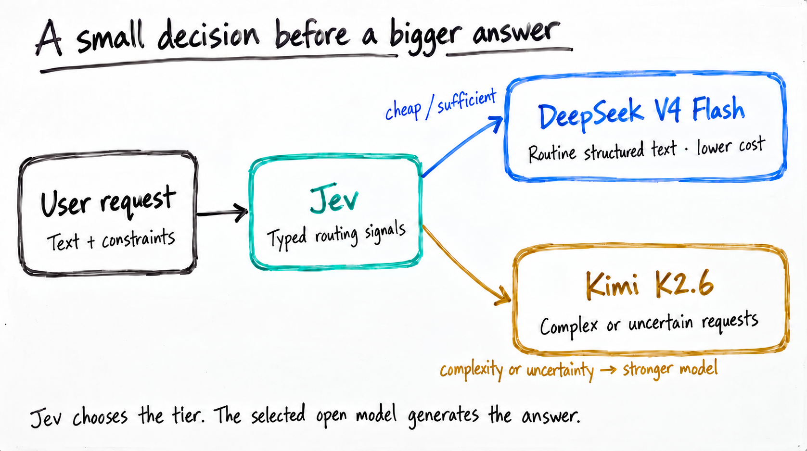

# Jev + Nebius router experiment

Jev routes requests to DeepSeek V4 Flash or Kimi K2.6 on Nebius. The benchmark compares routing with fixed open models and GPT-5.1 medium.



## Run

Requires Python 3.9+ on macOS or Linux. Set `JEV_API_KEY`, `NEBIUS_API_KEY`, and `OPENAI_API_KEY` in your environment.

```sh
python3 core/run.py run
python3 core/grade.py
```

The benchmark makes paid API calls. Grading is offline and requires the locally generated call ledger.

## Results

[30-task results](core/results/summary.json) · [Scored CSV](core/results/scored.csv) · [Tasks](core/tasks.json) · [Routing policy](core/results/protocol.json)

The full experiment showed **78% lower estimated API cost**, with **92.2% success versus GPT-5.1’s 96.7%**. The [exploratory 21-task subset](results/focused-cohort.json) showed 73.9% savings and 98.4% success versus 100%. Fixed Flash was cheaper and passed all attempts in that subset.

`validation/` contains the revised broad benchmark; the root scripts contain the original Qwen experiment. `confirmation/` is incomplete.

## Charts

```sh
pip install -r requirements.txt
python3 make_figures.py
```
